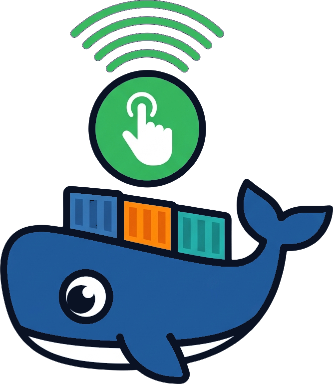
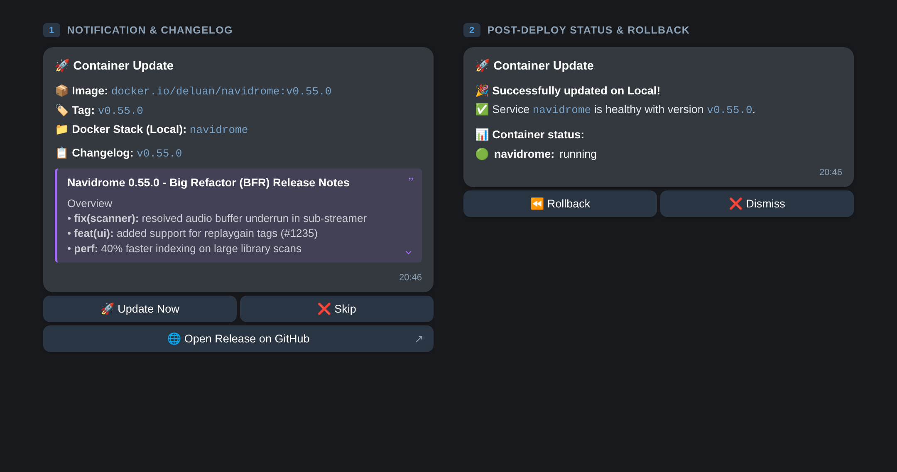
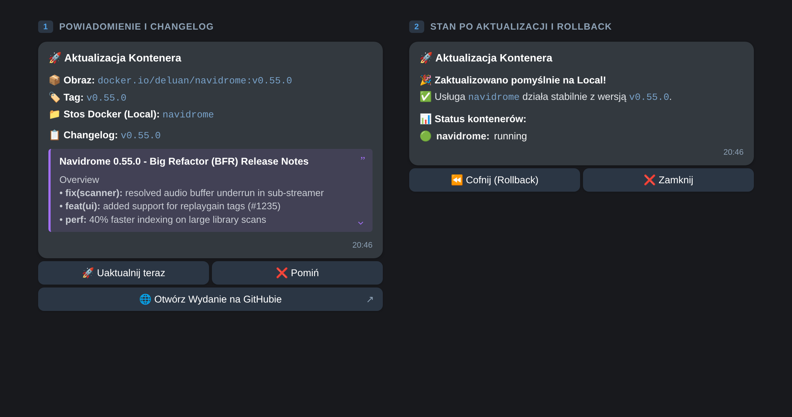

<div align="center">
  
  <h1>DiunTap</h1>
  <p>
    <b>Interactive 1-click Docker updates with GitHub changelogs, healthchecks & instant rollback for <a href="https://github.com/crazy-max/diun">DIUN</a>.</b><br />
    <i>Interaktywne aktualizacje kontenerów Docker 1 kliknięciem, changelogi z GitHuba, automatyczny healthcheck i natychmiastowy rollback dla DIUN.</i>
  </p>

  <p>
    <a href="#-english"><b>🇬🇧 English</b></a> •
    <a href="#-polski"><b>🇵🇱 Polski</b></a>
  </p>

  <p>
    <a href="LICENSE"></a>
    
    
    
    
  </p>
</div>

---

<div align="center">
  
</div>

---

## 🇬🇧 English

### 💡 What is DIUN and Why DiunTap?

> [!NOTE]
> **What is DIUN?**  
> [DIUN (Docker Image Update Notifier)](https://crazymax.dev/diun/) by [CrazyMax](https://github.com/crazy-max) is a lightweight open-source tool that monitors container registries (Docker Hub, GHCR, Quay) and sends alerts whenever a new image is published.

- **The problem with unattended auto-updaters (Watchtower):** Blindly updating containers at 3 AM can break critical services or database migrations while you sleep — with no changelog and no human approval.
- **The limitation of DIUN:** DIUN is great at detecting updates, but it only sends passive text notifications. It doesn't fetch GitHub release notes or let you trigger updates.
- **The DiunTap solution (Human-in-the-loop):** When DIUN detects a new image, DiunTap fetches the release notes from GitHub, sends a formatted Telegram message with inline action buttons, and lets you update the Compose service with a single tap on your phone. If the updated container fails its healthcheck or crashes, DiunTap sends the last 20 log lines and automatically rolls back to the previous image.

---

### 🏗️ How It Works

```text
┌────────────────────────────────────────────────────────┐
│             DIUN (Image Update Detector)               │
│  Scans registries (Docker Hub, GHCR, Quay, etc.)       │
└──────────────────────────┬─────────────────────────────┘
                           │ Webhook POST /webhook/diun
                           │ (optional X-Diun-Secret auth)
                           ▼
┌────────────────────────────────────────────────────────┐
│                        DiunTap                         │
│                                                        │
│  1. Verifies webhook secret (if configured)            │
│  2. Fetches Release Notes from GitHub API              │
│  3. Identifies Compose stack via labels or directory   │
│  4. Formats Telegram HTML with <blockquote expandable> │
│  5. Listens for button taps (LAN Long Polling)         │
└──────────────────────────┬─────────────────────────────┘
                           │ Telegram Bot API
                           ▼
┌────────────────────────────────────────────────────────┐
│               Your Telegram (Phone / Desktop)          │
│                                                        │
│  🚀 Container Update: navidrome                        │
│  📋 Changelog: v0.55.0 (collapsible quote)             │
│  [ 🚀 Update Now ]  [ ❌ Skip ]                        │
│  [ 🌐 Open Release on GitHub ]                         │
└──────────────────────────┬─────────────────────────────┘
                           │ Tap: [ 🚀 Update Now ]
                           ▼
┌────────────────────────────────────────────────────────┐
│                        DiunTap                         │
│                                                        │
│  1. Tags current images as restore points              │
│     (:diun-backup-<service>-<timestamp>)               │
│  2. Executes: docker compose pull && up -d             │
│  3. Polls health until stable (or timeout)             │
│  4. If healthy: ✅ Success! [ ⏪ Rollback ]            │
│  5. If failed:  ⚠️ last 20 log lines + auto-rollback   │
│     attempt + [ ⏪ Rollback ]                          │
└────────────────────────────────────────────────────────┘
```

---

### ✨ Key Features

- 🚀 **1-Click Human-in-the-Loop Updates** — review what changed and decide when to update directly from Telegram.
- 📋 **GitHub Changelogs in Expandable Quotes** — converts GitHub Release markdown into clean Telegram HTML inside `<blockquote expandable>` blocks so long changelogs never flood your chat.
- 🎯 **Automatic Stack Discovery** — finds your Compose project directory from running container labels (`com.docker.compose.project`) with a directory scan fallback.
- 🛡️ **Notification Deduplication** — bounded `TTLCache` prevents duplicate alerts when DIUN fires multiple webhooks for the same tag.
- 📌 **Pin & Freeze Filters** — use `EXCLUDE_IMAGES` (wildcards) and `PINNED_STACKS` (exact names) to silence notifications for services you want to keep on a fixed version.
- 🔒 **100% LAN & Zero-Trust Friendly (Long Polling)** — receives Telegram button presses over outbound Long Polling. **Zero open firewall ports, no reverse proxy, and no Cloudflare tunnel needed.**
- 🔑 **Webhook Authentication** — optional shared secret (`DIUN_WEBHOOK_SECRET` via `X-Diun-Secret` header or `?token=`).
- 👥 **Group-Safe Telegram Authorization** — checks the clicking user's numeric `from_user.id` against `TELEGRAM_ALLOWED_USER_IDS` (never trusts the group chat ID alone).
- 🩺 **Post-Update Healthcheck & Auto-Rollback** — waits for two consecutive healthy checks (minimum 60s window for containers with healthchecks). Confirmed failures (`unhealthy`, `exited`, `dead`, `restarting`) trigger an automatic rollback and send the last 20 lines of container logs.
- ⏪ **Persistent 1-Click Rollback** — stores button actions and image restore points in SQLite (`/data`), surviving container restarts for up to 7 days. Rollback uses `up -d --pull never` to restore the exact pre-update image ID.
- 🌐 **Optional Remote Node Support (SSH)** — manage remote Podman Quadlets or secondary hosts over SSH with strict host key checking and input allow-lists.
- 🌍 **Bilingual Notifications** — English (`LANGUAGE=en`) and Polish (`LANGUAGE=pl`).

---

### 🚀 Quickstart

DiunTap runs as a non-root user (`USER diuntap`, UID 1000) and requires the host's Docker socket group ID (`DOCKER_GID`) to manage containers.

#### 1. Clone & configure `.env`

```bash
git clone https://github.com/patientone-io/diun-tap.git
cd diun-tap
cp .env.example .env
stat -c %g /var/run/docker.sock   # Check your host's docker socket GID (e.g. 999 or 998)
```

Fill in the main settings in `.env`:

| Setting | What to enter |
| :--- | :--- |
| `TELEGRAM_BOT_TOKEN` | Bot token from [@BotFather](https://t.me/BotFather) (`/newbot`). Start a chat with your bot first! |
| `TELEGRAM_CHAT_ID` | Destination chat ID (send any message to [@userinfobot](https://t.me/userinfobot) to get your numeric ID). |
| `TELEGRAM_ALLOWED_USER_IDS` | Comma-separated numeric user IDs allowed to click buttons (recommended for group chats; defaults to `TELEGRAM_CHAT_ID`). |
| `DOCKER_STACKS_DIR` | Absolute path to your Compose stacks on the host, e.g. `/srv/docker` (mounted 1:1 into the container). |
| `DOCKER_GID` | Group ID printed by `stat -c %g /var/run/docker.sock` above. |
| `DIUN_WEBHOOK_SECRET` | Random secret generated with `openssl rand -hex 24` (set the same value in DIUN). |
| `LANGUAGE` | `en` or `pl`. |

#### 2. Connect DIUN & start the stack

- **If you don't run DIUN yet:** uncomment the `diun` service in [`compose.yaml`](compose.yaml) and set `X-Diun-Secret` to match your `DIUN_WEBHOOK_SECRET`.
- **If you already run DIUN:** add the webhook environment variables to your existing DIUN service:
  ```yaml
  environment:
    - "DIUN_NOTIF_WEBHOOK_ENDPOINT=http://<diuntap-host-or-container>:5000/webhook/diun"
    - "DIUN_NOTIF_WEBHOOK_METHOD=POST"
    - "DIUN_NOTIF_WEBHOOK_HEADERS=X-Diun-Secret: <same-secret-as-in-diuntap>"
  ```
  *(If both containers share a Docker network, use `http://diun-tap:5000/webhook/diun`.)*

Start DiunTap (and recreate DIUN if you updated its config):

```bash
docker compose up -d
curl http://localhost:5000/health
```

A healthy response returns `"status":"ok"`, `"telegram_configured":true`, and `"webhook_auth_enabled":true`.

---

### 🆘 Troubleshooting

| Problem | What to check |
| :--- | :--- |
| `Permission denied` on `/var/run/docker.sock` | Set `DOCKER_GID` in `.env` to match `stat -c %g /var/run/docker.sock` and recreate the container (`docker compose up -d`). |
| Webhook returns `401 Invalid webhook secret` | Make sure `DIUN_WEBHOOK_SECRET` in DiunTap matches the `X-Diun-Secret` header (or `?token=`) sent by DIUN. |
| Telegram button says `Unauthorized` | Add your personal numeric Telegram user ID (from `@userinfobot`, not the negative group ID) to `TELEGRAM_ALLOWED_USER_IDS`. |
| No notifications arriving | Check DIUN logs, webhook URL reachability, and verify the image isn't filtered out by `EXCLUDE_IMAGES` or `PINNED_STACKS`. |

<details>
<summary><strong>⚙️ Full Configuration Reference (<code>.env</code>)</strong></summary>

| Variable | Description | Default |
| :--- | :--- | :--- |
| `TELEGRAM_BOT_TOKEN` | Telegram Bot API token from `@BotFather` | *(Required)* |
| `TELEGRAM_CHAT_ID` | Telegram chat ID for notifications (and single-user allow-list fallback) | *(Required)* |
| `TELEGRAM_ALLOWED_USER_IDS` | Comma-separated user IDs allowed to tap buttons (`from_user.id` only) | `""` (falls back to `TELEGRAM_CHAT_ID`) |
| `DIUN_WEBHOOK_SECRET` | Shared secret for `/webhook/diun` (`X-Diun-Secret` or `?token=`); empty = legacy mode with warning | `""` *(Recommended)* |
| `GITHUB_TOKEN` | GitHub Personal Access Token (increases API rate limit from 60 to 5,000 req/h) | `""` *(Optional)* |
| `LANGUAGE` | Notification & button language (`en` or `pl`) | `en` |
| `LOCAL_NODE_NAME` | Display name for the local Docker host | `Local` |
| `DOCKER_STACKS_DIR` | Directory where Docker Compose stacks live (mounted 1:1) | `/srv/docker` |
| `DOCKER_GID` | Host group ID of `/var/run/docker.sock` (`group_add`) | `999` |
| `HEALTHCHECK_WAIT_SECONDS` | Observation window in seconds (containers with healthcheck get at least 60s) | `60` |
| `DIUNTAP_STATE_DIR` | SQLite directory for persistent button actions and restore points | `/data` in Docker (`./data` locally) |
| `SSH_TIMEOUT_SECONDS` | Timeout for a single SSH command | `30` |
| `DOCKER_TIMEOUT_SECONDS` | Timeout for `docker compose pull` / `up -d` | `180` |
| `WEBHOOK_PORT` | Listening port for the DIUN webhook server | `5000` |
| `MAPPINGS_FILE` | Path to custom image-to-GitHub-repo YAML/JSON file | `""` *(Optional)* |
| `EXCLUDE_IMAGES` | Comma-separated wildcard patterns of images to ignore (e.g. `vaultwarden/server,*:nightly`) | `""` *(Optional)* |
| `PINNED_STACKS` | Comma-separated stack/service names to freeze | `""` *(Optional)* |
| `REMOTE_SSH_HOST` | SSH host alias for optional remote node management | `""` *(Optional)* |
| `REMOTE_NODE_NAME` | Display name for the remote node | `Remote` |
| `REMOTE_CONFIGS_DIR` | Path to remote Quadlet/container config files | `/remote-configs` |

</details>

<details>
<summary><strong>🗺️ Custom Image Mappings, Remote Quadlets & Update Safety Details</strong></summary>

#### Custom GitHub release-note mappings (`mappings.yaml`)
DiunTap includes built-in mappings for dozens of popular self-hosted images (e.g. `linuxserver/jellyfin` → `jellyfin/jellyfin`). For custom images, mount a `mappings.yaml` file and set `MAPPINGS_FILE=/config/mappings.yaml`:

```yaml
images:
  my-app: "organization/my-app-repo"
  ghcr.io/internal/dashboard: "internal/dashboard"
```

#### Update & rollback safety rules
- **Tag-safe updates:** Only services matching the notification's repository and tag are updated. DiunTap never edits your `compose.yaml` or Quadlet files, and skips digest-pinned images. Unrelated services in the same Compose stack are not recreated.
- **Rollback scope:** Rollback restores the previous container image ID (`up -d --pull never`), keeping the newest 3 backup tags per image. **Note:** image rollback does not revert application data or database schema migrations — always keep regular backups of your volumes.
- **Remote Podman Quadlets:** When `REMOTE_SSH_HOST` is configured, DiunTap can update remote rootless Podman Quadlets over SSH (`ContainerName=` must match the unit basename, and `Pull=` should be default `missing` or `never`).

#### Building locally from source
```bash
docker build --build-arg DOCKER_GID="$(stat -c %g /var/run/docker.sock)" -t ghcr.io/patientone-io/diun-tap:latest .
docker compose up -d --pull never diun-tap
```

</details>

---

## 🇵🇱 Polski

<div align="center">
  
</div>

---

### 💡 Czym jest DIUN i dlaczego DiunTap?

> [!NOTE]
> **Czym jest DIUN?**  
> [DIUN (Docker Image Update Notifier)](https://crazymax.dev/diun/) autorstwa [CrazyMax](https://github.com/crazy-max) to lekkie narzędzie open-source monitorujące rejestry kontenerów (Docker Hub, GHCR, Quay) i wysyłające powiadomienia o pojawieniu się nowych wersji obrazów.

- **Problem z automatami typu Watchtower:** Automatyczne aktualizacje bez nadzoru potrafią wyłożyć ważną usługę lub bazę danych o 3 w nocy — bez znajomości changelogu i bez pytania Cię o zgodę.
- **Ograniczenie samego DIUN:** DIUN świetnie wykrywa aktualizacje, ale wysyła wyłącznie suche powiadomienia tekstowe. Nie pobiera opisu zmian (release notes) z GitHuba i nie pozwala uruchomić aktualizacji.
- **Rozwiązanie DiunTap (Human-in-the-loop):** Gdy DIUN wykryje nowy obraz, DiunTap pobiera changelog z GitHuba, wysyła czytelne powiadomienie na Telegrama z przyciskami akcji i pozwala zaktualizować usługę jednym kliknięciem z telefonu. Jeśli po aktualizacji kontener nie przejdzie healthchecka lub padnie, DiunTap przyśle ostatnie 20 linijek logów i automatycznie przywróci poprzedni działający obraz (Rollback).

---

### 🏗️ Jak to działa?

```text
┌────────────────────────────────────────────────────────┐
│             DIUN (detektor nowych obrazów)             │
│  Skanuje rejestry (Docker Hub, GHCR, Quay, itd.)       │
└──────────────────────────┬─────────────────────────────┘
                           │ Webhook POST /webhook/diun
                           │ (opcjonalnie X-Diun-Secret)
                           ▼
┌────────────────────────────────────────────────────────┐
│                        DiunTap                         │
│                                                        │
│  1. Weryfikuje sekret webhooka (jeśli ustawiony)       │
│  2. Pobiera Release Notes z GitHub API                 │
│  3. Wykrywa stos Compose (etykiety lub katalog)        │
│  4. Formatuje HTML z <blockquote expandable>           │
│  5. Nasłuchuje kliknięć (Long Polling w LAN)           │
└──────────────────────────┬─────────────────────────────┘
                           │ Telegram Bot API
                           ▼
┌────────────────────────────────────────────────────────┐
│               Twój Telegram (telefon / PC)             │
│                                                        │
│  🚀 Aktualizacja: navidrome                            │
│  📋 Changelog: v0.55.0 (zwijany cytat)                 │
│  [ 🚀 Uaktualnij teraz ]  [ ❌ Pomiń ]                 │
│  [ 🌐 Otwórz Wydanie na GitHubie ]                     │
└──────────────────────────┬─────────────────────────────┘
                           │ Klik: [ 🚀 Uaktualnij teraz ]
                           ▼
┌────────────────────────────────────────────────────────┐
│                        DiunTap                         │
│                                                        │
│  1. Taguje obrazy jako punkty przywracania             │
│     (:diun-backup-<service>-<timestamp>)               │
│  2. Wykonuje: docker compose pull && up -d             │
│  3. Czeka na stabilizację (polling healthchecka)       │
│  4. Sukces: ✅ Gotowe! [ ⏪ Cofnij ]                   │
│  5. Błąd: ⚠️ 20 linijek logów + próba auto-rollbacku   │
│     + [ ⏪ Cofnij ]                                    │
└────────────────────────────────────────────────────────┘
```

---

### ✨ Główne funkcje

- 🚀 **Aktualizacje 1 kliknięciem (Human-in-the-Loop)** — sam decydujesz, kiedy zaktualizować kontener, klikając przycisk w Telegramie.
- 📋 **Changelogi z GitHuba w zwijanych blokach** — formatuje opisy wydań z GitHuba do natywnych bloków `<blockquote expandable>` w Telegramie (czytelne nagłówki, linki do PR-ów i zwijana treść, która nie zaśmieca czatu).
- 🎯 **Automatyczne wykrywanie stosów Compose** — odczytuje ścieżkę projektu prosto z etykiet działających kontenerów (`com.docker.compose.project`) z zapasowym skanowaniem katalogów na dysku.
- 🛡️ **Deduplikacja powiadomień** — wbudowany `TTLCache` zapobiega podwójnym powiadomieniom o tym samym tagu.
- 📌 **Przypinanie i zamrażanie wersji** — zmienne `EXCLUDE_IMAGES` (wzorce z `*`) oraz `PINNED_STACKS` (dokładne nazwy) wyciszają powiadomienia dla usług, których nie chcesz aktualizować.
- 🔒 **100% lokalnie bez wystawiania portów (Long Polling)** — odbiera kliknięcia przycisków przez połączenia wychodzące. **Nie wymaga przekierowania portów, publicznej domeny ani tuneli Cloudflare.**
- 🔑 **Autoryzacja webhooka DIUN** — opcjonalny wspólny sekret (`DIUN_WEBHOOK_SECRET` w nagłówku `X-Diun-Secret` lub `?token=`).
- 👥 **Bezpieczne działanie w grupach** — weryfikuje numeryczne ID klikającego użytkownika (`from_user.id`) względem listy `TELEGRAM_ALLOWED_USER_IDS`.
- 🩺 **Automatyczny Healthcheck i Auto-Rollback** — po aktualizacji sprawdza stan kontenera (wymaga dwóch kolejnych poprawnych odczytów; minimum 60 s dla kontenerów z healthcheckiem). W razie awarii (`unhealthy`, `exited`, `dead`, `restarting`) wysyła na czat 20 ostatnich linii logów i automatycznie cofa aktualizację.
- ⏪ **Trwały 1-Click Rollback** — zapisuje akcje przycisków i punkty przywracania w bazie SQLite (`/data`), dzięki czemu przyciski działają nawet po restarcie kontenera (do 7 dni). Rollback przywraca dokładny identyfikator poprzedniego obrazu (`up -d --pull never`).
- 🌐 **Opcjonalna obsługa zdalnych węzłów (SSH)** — możliwość aktualizacji zdalnych jednostek Podman Quadlet po SSH.
- 🌍 **Dwujęzyczny interfejs** — pełna obsługa języka polskiego (`LANGUAGE=pl`) oraz angielskiego (`LANGUAGE=en`).

---

### 🚀 Szybki start

Kontener DiunTap działa jako użytkownik bez uprawnień roota (`USER diuntap`, UID 1000) i wymaga podania identyfikatora grupy gniazda Dockera z hosta (`DOCKER_GID`).

#### 1. Sklonuj repozytorium i uzupełnij `.env`

```bash
git clone https://github.com/patientone-io/diun-tap.git
cd diun-tap
cp .env.example .env
stat -c %g /var/run/docker.sock   # Sprawdź GID gniazda Dockera na swoim hoście (np. 999 lub 998)
```

Wypełnij najważniejsze pola w pliku `.env`:

| Ustawienie | Co wpisać |
| :--- | :--- |
| `TELEGRAM_BOT_TOKEN` | Token bota utworzonego w [@BotFather](https://t.me/BotFather) (`/newbot`). Pamiętaj, aby najpierw kliknąć **Start** w rozmowie z botem! |
| `TELEGRAM_CHAT_ID` | ID docelowego czatu (napisz dowolną wiadomość do [@userinfobot](https://t.me/userinfobot), aby poznać swoje numeryczne `Id`). |
| `TELEGRAM_ALLOWED_USER_IDS` | Numeryczne ID osób uprawnionych do klikania przycisków, oddzielone przecinkami (zalecane w grupach; domyślnie używa `TELEGRAM_CHAT_ID`). |
| `DOCKER_STACKS_DIR` | Pełna ścieżka do katalogu z Twoimi projektami Compose na hoście, np. `/srv/docker` (montowana 1:1 do kontenera). |
| `DOCKER_GID` | Numer grupy zwrócony wyżej przez `stat -c %g /var/run/docker.sock`. |
| `DIUN_WEBHOOK_SECRET` | Losowy sekret wygenerowany np. przez `openssl rand -hex 24` (ustaw tę samą wartość w DIUN). |
| `LANGUAGE` | `pl` albo `en`. |

#### 2. Podłącz DIUN i uruchom kontenery

- **Jeśli nie masz jeszcze DIUN:** odkomentuj sekcję `diun` w pliku [`compose.yaml`](compose.yaml) i wpisz swój sekret w nagłówku `X-Diun-Secret`.
- **Jeśli masz już działającego DIUN-a:** dopisz zmienne webhooka do jego konfiguracji `compose.yaml`:
  ```yaml
  environment:
    - "DIUN_NOTIF_WEBHOOK_ENDPOINT=http://<adres-diuntap>:5000/webhook/diun"
    - "DIUN_NOTIF_WEBHOOK_METHOD=POST"
    - "DIUN_NOTIF_WEBHOOK_HEADERS=X-Diun-Secret: <ten-sam-sekret-co-w-diuntap>"
  ```
  *(Jeśli oba kontenery są w tej samej sieci Dockera, wpisz po prostu `http://diun-tap:5000/webhook/diun`.)*

Uruchom DiunTap (oraz przeładuj DIUN, jeśli zmieniałeś jego konfigurację):

```bash
docker compose up -d
curl http://localhost:5000/health
```

Poprawna odpowiedź zawiera `"status":"ok"`, `"telegram_configured":true` oraz `"webhook_auth_enabled":true`.

---

### 🆘 Rozwiązywanie problemów

| Problem | Co sprawdzić |
| :--- | :--- |
| `Permission denied` na `/var/run/docker.sock` | Ustaw `DOCKER_GID` w `.env` zgodnie z wynikiem `stat -c %g /var/run/docker.sock` i odtwórz kontener (`docker compose up -d`). |
| Webhook zwraca `401 Invalid webhook secret` | Upewnij się, że `DIUN_WEBHOOK_SECRET` w DiunTap jest identyczny z nagłówkiem `X-Diun-Secret` (lub `?token=`) w DIUN. |
| Przycisk w Telegramie zwraca `Brak uprawnień` | Wpisz swoje osobiste numeryczne ID użytkownika (z `@userinfobot`, a nie ujemne ID grupy) w `TELEGRAM_ALLOWED_USER_IDS`. |
| Brak powiadomień | Sprawdź logi DIUN, dostępność adresu webhooka oraz czy obraz nie jest wykluczony przez `EXCLUDE_IMAGES` lub `PINNED_STACKS`. |

<details>
<summary><strong>⚙️ Pełna tabela zmiennych konfiguracyjnych (<code>.env</code>)</strong></summary>

| Zmienna | Opis | Domyślnie |
| :--- | :--- | :--- |
| `TELEGRAM_BOT_TOKEN` | Token bota z `@BotFather` | *(Wymagany)* |
| `TELEGRAM_CHAT_ID` | ID czatu do powiadomień (oraz domyślne ID uprawnionego w trybie prywatnym) | *(Wymagany)* |
| `TELEGRAM_ALLOWED_USER_IDS` | Lista ID użytkowników uprawnionych do klikania przycisków (`from_user.id`) | `""` (fallback do `TELEGRAM_CHAT_ID`) |
| `DIUN_WEBHOOK_SECRET` | Wspólny sekret `/webhook/diun` (`X-Diun-Secret` lub `?token=`); pusty = tryb legacy z ostrzeżeniem | `""` *(Zalecany)* |
| `GITHUB_TOKEN` | Osobisty token GitHub (zwiększa limit API z 60 do 5000 zapytań/h) | `""` *(Opcjonalny)* |
| `LANGUAGE` | Język powiadomień i przycisków (`pl` lub `en`) | `en` |
| `LOCAL_NODE_NAME` | Nazwa lokalnego hosta wyświetlana w powiadomieniach | `Local` |
| `DOCKER_STACKS_DIR` | Katalog ze stosami Docker Compose (montowany 1:1) | `/srv/docker` |
| `DOCKER_GID` | GID gniazda `/var/run/docker.sock` z hosta (`group_add`) | `999` |
| `HEALTHCHECK_WAIT_SECONDS` | Czas obserwacji po aktualizacji w sekundach (dla healthchecka min. 60 s) | `60` |
| `DIUNTAP_STATE_DIR` | Katalog bazy SQLite przechowującej akcje i punkty przywracania | `/data` w Dockerze (`./data` lokalnie) |
| `SSH_TIMEOUT_SECONDS` | Timeout pojedynczej komendy SSH | `30` |
| `DOCKER_TIMEOUT_SECONDS` | Timeout operacji `docker compose pull` / `up -d` | `180` |
| `WEBHOOK_PORT` | Port nasłuchiwania webhooka DIUN | `5000` |
| `MAPPINGS_FILE` | Ścieżka do własnego pliku mapowań obrazów YAML/JSON | `""` *(Opcjonalnie)* |
| `EXCLUDE_IMAGES` | Wzorce obrazów pomijanych w powiadomieniach, po przecinku (np. `vaultwarden/server,*:nightly`) | `""` *(Opcjonalnie)* |
| `PINNED_STACKS` | Nazwy stosów lub usług zamrożonych przed aktualizacją | `""` *(Opcjonalnie)* |
| `REMOTE_SSH_HOST` | Alias SSH opcjonalnego zdalnego węzła | `""` *(Opcjonalnie)* |
| `REMOTE_NODE_NAME` | Nazwa wyświetlana zdalnego węzła | `Remote` |
| `REMOTE_CONFIGS_DIR` | Katalog zdalnych plików Quadlet/kontenerów | `/remote-configs` |

</details>

<details>
<summary><strong>🗺️ Własne mapowania obrazów, zdalne Quadlety i zasady bezpieczeństwa aktualizacji</strong></summary>

#### Własne mapowania repozytoriów GitHub (`mappings.yaml`)
DiunTap posiada wbudowane mapowania dla dziesiątek popularnych obrazów (np. `linuxserver/jellyfin` → `jellyfin/jellyfin`). Dla własnych obrazów utwórz plik `mappings.yaml`, zamontuj go w kontenerze i ustaw `MAPPINGS_FILE=/config/mappings.yaml`:

```yaml
images:
  my-app: "organization/my-app-repo"
  ghcr.io/internal/dashboard: "internal/dashboard"
```

#### Bezpieczeństwo aktualizacji i rollbacku
- **Aktualizacja wyłącznie zgodnych tagów:** DiunTap aktualizuje tylko usługi zgodne z repozytorium i tagiem z powiadomienia. Nie modyfikuje plików `compose.yaml` ani Quadletów i pomija obrazy przypięte do digestu (`@sha256:...`). Pozostałe usługi w tym samym pliku Compose nie są restartowane.
- **Zakres rollbacku:** Rollback przywraca poprzedni identyfikator obrazu kontenera (`up -d --pull never`), przechowując do 3 ostatnich kopii tagów na obraz. **Pamiętaj:** cofnięcie obrazu nie cofa migracji bazy danych ani zmian w wolumenach danych — wykonuj regularne kopie zapasowe danych aplikacji.
- **Zdalne Quadlety Podmana:** Po skonfigurowaniu `REMOTE_SSH_HOST` DiunTap potrafi aktualizować zdalne jednostki rootless Podman Quadlet po SSH (`ContainerName=` musi odpowiadać nazwie usługi, a polityka `Pull=` powinna mieć wartość domyślną `missing` lub `never`).

#### Budowanie obrazu lokalnie ze źródeł
```bash
docker build --build-arg DOCKER_GID="$(stat -c %g /var/run/docker.sock)" -t ghcr.io/patientone-io/diun-tap:latest .
docker compose up -d --pull never diun-tap
```

</details>

---

## 👤 Author & Contact / Autor i kontakt

- **Author / Twórca:** [patientone](https://github.com/patientone-io)
- **Website / Strona:** [patientone.uk](https://patientone.uk)
- **E-mail:** [contact@patientone.uk](mailto:contact@patientone.uk)

## 📄 License / Licencja

MIT License — see [LICENSE](LICENSE) for details / szczegóły w pliku [LICENSE](LICENSE).
